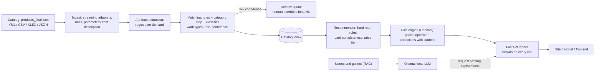

# RepairCalc — smart repair calculators for Maxidom

[](https://github.com/Hisoka742/repaircalc-maxidom/actions/workflows/ci.yml)


A microservice that turns room dimensions or a product card into **material quantities in real packs**
plus a cost estimate, and links the Maxidom catalog (88,790 products) to repair work types automatically.
**A deterministic engine does the arithmetic; the language model never computes a number**, it only
reads text.

Team **Les dz**, SpbTechRun 2026, case 1. Russian version: [README.md](README.md).

> **Status: Checkpoint 1, work in progress.** The engine, the API, catalog ingestion and product matching
> run on the organizers' real dataset. Matching quality against human labels is **not measured yet**
> (labelling is in progress); every number in the metrics table carries a status. Details:
> [docs/CHECKPOINT_1.md](docs/CHECKPOINT_1.md) (Russian).

## Problem and the three scenarios

| case scenario | endpoint | what it does |
|---|---|---|
| 1. General calculator | `POST /api/v1/calc/property` | property type, renovation class, area → rooms → materials estimate and approximate labor cost |
| 2. Room-specific calculator | `POST /api/v1/calc/room`, `POST /api/v1/recommend` | dimensions, openings, humidity, load → materials for the room; hard room rules (wet zone → moisture-resistant products) |
| 3. Product-card calculator | `POST/GET /api/v1/product/{id}/calc` | how many packs of **this** product the user's dimensions need, plus companions |

The key link of the case: an admin binds products to calculators and ML speeds up binding the catalog
(upload → automatic labels → review queue for uncertain items).

## Architecture



More: [docs/ARCHITECTURE.md](docs/ARCHITECTURE.md).

## Key ideas

* **The LLM never computes numbers.** The engine (`src/maxicalc/engine`) is pure `Decimal` functions,
  rounded once at the end to a real pack.
* **`explain` on every estimate line**: the formula, the substituted values, the source of each value,
  the rounding step.
* **Pack optimizer**: picks a combination of pack sizes for the need and the price.
* **Correction coefficients as data** (`knowledge/corrections.yaml`, `waste_coefficients.yaml`): work ×
  material × conditions, each value with a source (URL, quote) or an explicit `derived` mark;
  [docs/COEFFICIENTS.md](docs/COEFFICIENTS.md).
* **Hard room constraints**: a product unfit for a wet zone never reaches a bathroom, however it ranks.
* **Review queue**: matches below the confidence threshold go to a human; a manual decision survives a
  catalog re-match.
* **Closed loop on a laptop**: everything runs on CPU with no external service; an LLM address outside
  the local network is refused.
* **Honest metrics**: every number is tagged REAL / SILVER / PILOT / SYNTHETIC / NOT MEASURED; the test
  set is frozen by hash and every look at it is logged ([docs/TUNING_LOG.md](docs/TUNING_LOG.md)).

## Quickstart

Python 3.12 is required. The organizers' dataset is **not** part of the repository: download
`products_final.json` from the organizers' link and put it at **`data/raw/products_final.json`** (the
`data/` folder is git-ignored).

```bash
git clone https://github.com/Hisoka742/repaircalc-maxidom.git && cd repaircalc-maxidom
python -m venv .venv && source .venv/bin/activate      # Windows: .venv\Scripts\activate
make install        # pip install -e ".[dev]" (or uv sync when uv is installed)
make test           # ruff + mypy + pytest (no dataset needed: tests that need it are skipped)
make eval           # golden calculations, extraction, matching, recommendation -> eval/REPORT.md
make ingest         # per-category data-quality report -> docs/DATASET_REPORT.md (needs the dataset)
make run            # service on http://127.0.0.1:8000, docs at /docs
make demo           # end-to-end scenario on the dataset: start, estimate, catalog upload, new product
```

`make serve CATALOG=data/raw/products_final.json` starts the service with the catalog (loading and
labelling 88,790 products takes about two minutes on a laptop). Without `CATALOG_PATH` the service starts
with an empty catalog. Environment variables are in `.env.example`; `docker compose up` brings the service
up with Postgres, Redis and Ollama.

## API examples

Estimate for a 4×3 m living room (real catalog, response shortened):

```bash
curl -s -X POST http://127.0.0.1:8000/api/v1/calc/room -H "Content-Type: application/json" \
  -d '{"room":{"length_m":"4","width_m":"3","height_m":"2.7"},"room_type":"living","renovation_class":"cosmetic"}'
```

```json
{ "basket": { "materials_total": "28422", "lines": [
  { "name": "ламинат DERBY Style 33кл/8мм Дуб геката Ф4 1380х190мм 2,098м²", "qty_packs": 7, "unit": "уп",
    "unit_price": "2599", "line_total": "18193", "group": "floor",
    "explain": [
      "Гостиная: 12 м² × (1 + 0.05) [straight; Quick-Step ...: straight 5 %, herringbone 5-10 %, diagonal 15-20 %; upper end] = 12.60 м²",
      "Итого по всем помещениям: 12.60 м²; ceil(12.60 / 2.0976) = 7 уп" ] } ],
  "warnings": [] } }
```

Product-card calculator (laminate, 4×3 m floor): packs of this product plus companions.

```bash
curl -s -X POST http://127.0.0.1:8000/api/v1/product/52513/calc -H "Content-Type: application/json" \
  -d '{"floor":{"length_m":"4","width_m":"3"}}'
# -> laminate 7 packs (12 × 1.05 = 12.60 m² / 2.0976 m²), underlay 2 packs, skirting 6 pcs; total 20,109 RUB
```

Matching a new product to work types (milliseconds, with confidence and evidence):

```bash
curl -s -X POST http://127.0.0.1:8000/api/v1/catalog/work-types/classify -H "Content-Type: application/json" \
  -d '{"name":"саморез по гипсокартону 3,5x35 мм фосфатированный 200 шт","category":"Строительные материалы > Метизы, крепежные изделия > Саморезы, шурупы"}'
```

```json
{ "item": { "work_types": [ { "work": "drywall_install", "role": "material",
  "confidence": 0.97, "source": "rule", "evidence": "screw-drywall" } ], "review": false },
  "milliseconds": 9.56 }
```

Whole-catalog upload: `POST /api/v1/catalog/upload` (YML/CSV/XLSX/JSON, `.gz` allowed) → background job →
results with confidence and a review queue (`GET /api/v1/catalog/upload/{job}/review`).

| | |
|---|---|
|  |  |
| API docs (Swagger) | `calc/room` response: basket lines and the calculation trace |
|  |  |
| Work-type labeling app | Calculator page (frontend) |

## Metrics and their status

Statuses: **REAL** — measured on real data; **SILVER** — labels come from our own rules (a
reproducibility check, not accuracy); **PILOT** — labelled by a single LLM labeller, not by humans;
**SYNTHETIC** — generated data; **NOT MEASURED** — not measured yet.

| metric | value | status |
|---|---|---|
| Organizers' dataset: products / priced / with brand | 88,790 / 99.8 % / 68.5 % | REAL |
| Full run (ingest, extraction, types, work types, readiness) on a laptop, 4 cores, 15.8 GB, no GPU | **140 s**, peak RAM **1.2 GB** | REAL |
| Golden calculations: all / checked against manufacturer tables | 288 / 72 (packs 26/26 exact, MAPE 0.316 %) | REAL |
| Card readiness: wallpaper 1297/1297, wall paint 376/379, laminate class 33 180/180, floor porcelain 899/950 | card + extraction + documented defaults | REAL |
| Single request on the real catalog: room estimate / new product / upload of 300 products | 2 ms / 8–10 ms / 0.56 s | REAL (one-off timings) |
| Calculation latency at 200 req/s: p95 (cold cache / mixed / 10 min) | 40.4 / 22.2 / 18.2 ms | SYNTHETIC (10,000 generated products, real code) |
| Work types: micro-F1 on 297 held-out categories | 0.857 | SILVER |
| Per-product matcher vs per-category baseline, ambiguous rows, fresh sets B and C | +0.04 and +0.07 micro-F1 | PILOT |
| Frozen test D (203 rows, one logged look): rules / category baseline | 0.829 / 0.742 micro-F1 | PILOT |
| Earlier matching score (macro-F1 0.951), extraction (1.000), recommendation nDCG | — | SYNTHETIC |
| micro-F1, macro-F1, per-work F1, Cohen κ, Krippendorff α **against humans** | — | NOT MEASURED |
| Local LLMs (Qwen3, GigaChat 3.1): accuracy and latency on CPU | — | NOT MEASURED |

Only REAL rows are quoted on stage. Method: [docs/EVAL_METHODOLOGY.md](docs/EVAL_METHODOLOGY.md); all
metrics: [docs/PITCH_METRICS.md](docs/PITCH_METRICS.md).

## Status and roadmap

**Done.** Calculation and pack engine with `explain`; the API of the three scenarios; streaming ingestion of
the 274 MB dataset; a category → work type map for 2,421 categories; a 42-work-type taxonomy with roles;
product-level rules and a product role (main / accessory / tool / consumable / protective gear); the
labeling app and guide; an 850-product gold set ready for labelling; the frontend.

**In progress.** Human labelling of the gold set (4 sheets); an ML model for work types as the main engine
(rules stay as a feature and a fallback); a benchmark of local LLMs through Ollama for a gray-zone judge.

**Next.** Metrics against humans and annotator agreement; model selection on the gold set; refit on orders
when data appears; UI; connection to the organizers' stand.

## Documents

| document | about |
|---|---|
| [docs/CHECKPOINT_1.md](docs/CHECKPOINT_1.md) | the team's checkpoint 1 report (Russian): done, evidence, risks, questions |
| [docs/ARCHITECTURE.md](docs/ARCHITECTURE.md) | layers, endpoints, models and resources |
| [docs/API.md](docs/API.md) | API contract, error codes, settings |
| [docs/EVAL_METHODOLOGY.md](docs/EVAL_METHODOLOGY.md) | evaluation method: sets, metrics, annotator agreement |
| [docs/TAXONOMY.md](docs/TAXONOMY.md) | work types, roles, labelling rules and edge cases |
| [docs/COEFFICIENTS.md](docs/COEFFICIENTS.md) | correction coefficients and their sources |
| [docs/DATASET_REPORT.md](docs/DATASET_REPORT.md) | data quality of the organizers' dataset per category |
| [docs/CATEGORY_MAP.md](docs/CATEGORY_MAP.md) | category → work type map and the comparison with per-product matching |
| [docs/FULL_RUN.md](docs/FULL_RUN.md) | timings of the full run on 88,790 products |
| [docs/PITCH_METRICS.md](docs/PITCH_METRICS.md) | all metrics with a status tag |
| [docs/LABELING_GUIDE.md](docs/LABELING_GUIDE.md) | labeller's guide |
| [docs/TUNING_LOG.md](docs/TUNING_LOG.md), [docs/TEST_ACCESS_LOG.md](docs/TEST_ACCESS_LOG.md) | guard against overfitting to the test |
| [docs/OPEN_QUESTIONS.md](docs/OPEN_QUESTIONS.md) | questions to the organizers and code assumptions |
| [docs/CASE_MATRIX.md](docs/CASE_MATRIX.md) | case requirements → module, endpoint, test |
| [docs/RUNBOOK.md](docs/RUNBOOK.md), [docs/SERVER_RUNBOOK.md](docs/SERVER_RUNBOOK.md), [docs/DAY_OF.md](docs/DAY_OF.md) | running, server, hackathon day |
| [docs/INTEGRATION.md](docs/INTEGRATION.md), [docs/LLM.md](docs/LLM.md) | stand integration, local LLM choice |

## Repository layout

```
src/maxicalc/   engine/ (pure formulas), service/, catalog/ (adapters), ml/, recommend/, api/, knowledge/ (YAML data)
tests/          unit, property, golden and API tests (no dataset needed)
scripts/        ingestion, training, evaluation, reports, labeling app
eval/           evaluation reports, gold and pilot sets
docs/           documentation
frontend/       UI (React + Vite)
```

## Team

| member | role |
|---|---|
| _name_ | _role_ |
| _name_ | _role_ |
| _name_ | _role_ |
| _name_ | _role_ |
