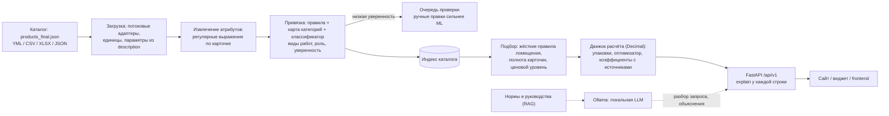
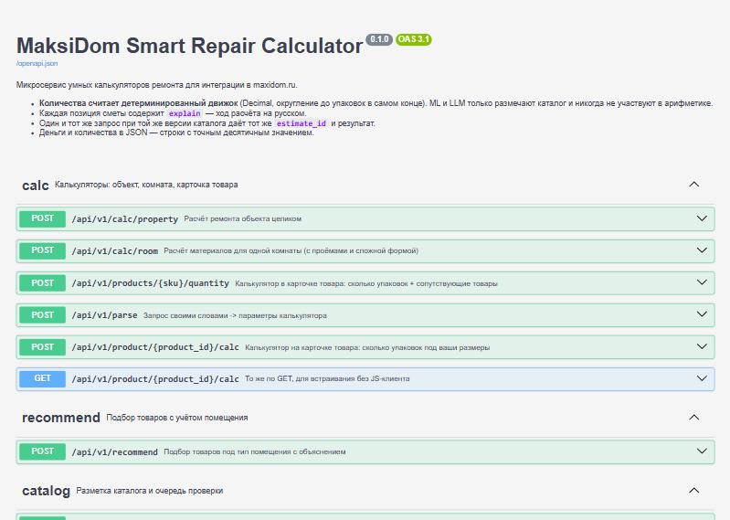
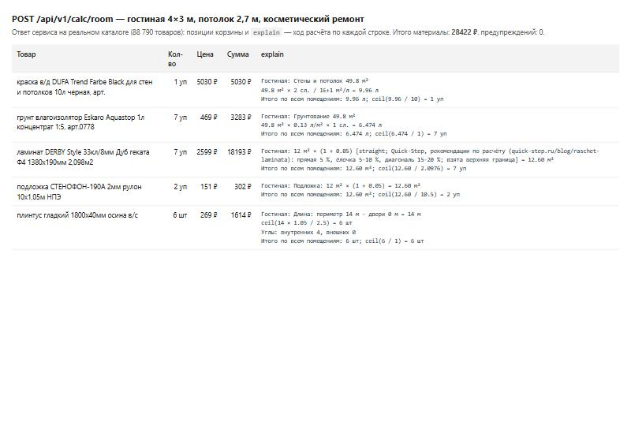
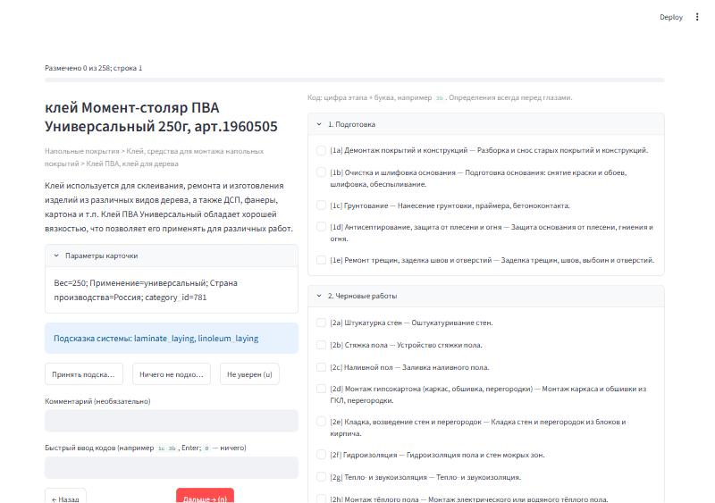
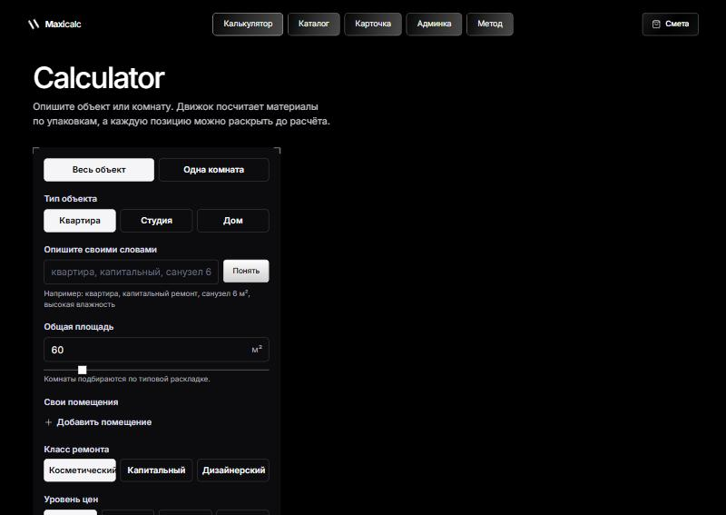

# RepairCalc — умные калькуляторы ремонта для Максидом

[](https://github.com/Hisoka742/repaircalc-maxidom/actions/workflows/ci.yml)


Микросервис, который по размерам помещения или по карточке товара считает **количество материалов в
упаковках** и стоимость, а каталог Максидом (88 790 товаров) сам привязывает к видам ремонтных работ.
**Числа считает детерминированный движок, языковая модель их не считает**: она только понимает текст.

Команда **Les dz**, SpbTechRun 2026, кейс 1. English: [README.en.md](README.en.md).

> **Статус: Checkpoint 1, работа продолжается.** Движок, API, загрузка каталога и привязка товаров
> работают на реальном наборе организаторов. Метрики качества привязки относительно людей ещё **не
> измерены** (разметка не завершена); в таблице метрик у каждого числа указан статус. Подробно:
> [docs/CHECKPOINT_1.md](docs/CHECKPOINT_1.md).

## Задача и три сценария

| сценарий кейса | эндпоинт | что делает |
|---|---|---|
| 1. Общий калькулятор | `POST /api/v1/calc/property` | тип объекта, класс ремонта, площадь → комнаты → смета материалов и ориентировочная стоимость работ |
| 2. Калькулятор по помещению | `POST /api/v1/calc/room`, `POST /api/v1/recommend` | размеры, проёмы, влажность, нагрузка → материалы под помещение; жёсткие правила (мокрая зона → влагостойкие материалы) |
| 3. Калькулятор в карточке товара | `POST/GET /api/v1/product/{id}/calc` | сколько упаковок **этого** товара нужно под размеры пользователя + сопутствующие |

Ключевая связка кейса: администратор привязывает товары к калькуляторам, а ML ускоряет привязку каталога
(загрузка → автоматические метки → очередь проверки для неуверенных).

## Архитектура



Подробнее: [docs/ARCHITECTURE.md](docs/ARCHITECTURE.md).

## Ключевые идеи

* **LLM не считает числа.** Движок (`src/maxicalc/engine`) — чистые функции на `Decimal`, округление один
  раз в конце до реальной упаковки. Модель размечает текст и объясняет результат.
* **`explain` у каждой строки сметы**: формула, подставленные значения, источник значения, шаг округления.
* **Оптимизатор упаковок**: подбор комбинации фасовок под потребность и цену.
* **Поправочные коэффициенты как данные** (`knowledge/corrections.yaml`, `waste_coefficients.yaml`): работа ×
  материал × условия, у каждого значения источник (URL, цитата) или явная пометка `derived`;
  [docs/COEFFICIENTS.md](docs/COEFFICIENTS.md).
* **Жёсткие ограничения помещения**: товар, не подходящий для влажной зоны, не попадёт в ванную, как бы он
  ни ранжировался.
* **Очередь проверки**: привязка ниже порога уверенности уходит человеку; ручное решение переживает пересчёт
  каталога.
* **Замкнутый контур на ноутбуке**: всё работает на CPU, без внешних сервисов; адрес LLM вне локальной сети
  отклоняется.
* **Честные метрики**: каждое число помечено REAL / SILVER / PILOT / SYNTHETIC / NOT MEASURED; тест
  заморожен по хэшу и каждое обращение к нему записывается ([docs/TUNING_LOG.md](docs/TUNING_LOG.md)).

## Быстрый старт

Нужен Python 3.12. Набор данных организаторов в репозиторий **не входит**: скачайте `products_final.json`
по ссылке организаторов и положите его в **`data/raw/products_final.json`** (папка `data/` в `.gitignore`).

```bash
git clone https://github.com/Hisoka742/repaircalc-maxidom.git && cd repaircalc-maxidom
python -m venv .venv && source .venv/bin/activate      # Windows: .venv\Scripts\activate
make install        # pip install -e ".[dev]" (или uv sync, если установлен uv)
make test           # ruff + mypy + pytest (набор данных не нужен: тесты, которым он нужен, пропускаются)
make eval           # эталонные расчёты, извлечение, привязка, подбор -> eval/REPORT.md
make ingest         # отчёт о качестве данных по каждой категории -> docs/DATASET_REPORT.md (нужен набор данных)
make run            # сервис на http://127.0.0.1:8000, документация: /docs
make demo           # сквозной сценарий на наборе данных: старт сервиса, смета, загрузка каталога, новый товар
```

`make serve CATALOG=data/raw/products_final.json` запускает сервис с каталогом (загрузка и разметка 88 790
товаров занимают около двух минут на ноутбуке). Без `CATALOG_PATH` сервис стартует с пустым каталогом.
Переменные окружения — в `.env.example`; `docker compose up` поднимает сервис вместе с Postgres, Redis и Ollama.

## Примеры API

Смета для гостиной 4×3 м (реальный каталог, ответ сокращён):

```bash
curl -s -X POST http://127.0.0.1:8000/api/v1/calc/room -H "Content-Type: application/json" \
  -d '{"room":{"length_m":"4","width_m":"3","height_m":"2.7"},"room_type":"living","renovation_class":"cosmetic"}'
```

```json
{ "basket": { "materials_total": "28422", "lines": [
  { "name": "ламинат DERBY Style 33кл/8мм Дуб геката Ф4 1380х190мм 2,098м²", "qty_packs": 7, "unit": "уп",
    "unit_price": "2599", "line_total": "18193", "group": "floor",
    "explain": [
      "Гостиная: 12 м² × (1 + 0.05) [straight; Quick-Step, рекомендации по расчёту: прямая 5 %, ёлочка 5-10 %, диагональ 15-20 %; взята верхняя граница] = 12.60 м²",
      "Итого по всем помещениям: 12.60 м²; ceil(12.60 / 2.0976) = 7 уп" ] },
  { "name": "краска в/д DUFA Trend Farbe Black для стен и потолков 10л черная", "qty_packs": 1, "unit": "уп",
    "line_total": "5030", "explain": ["Гостиная: Стены и потолок 49.8 м²", "…", "ceil(9.96 / 10) = 1 уп"] } ],
  "warnings": [] } }
```

Калькулятор в карточке товара (ламинат, пол 4×3 м): упаковки этого товара и сопутствующие.

```bash
curl -s -X POST http://127.0.0.1:8000/api/v1/product/52513/calc -H "Content-Type: application/json" \
  -d '{"floor":{"length_m":"4","width_m":"3"}}'
# -> ламинат 7 уп (12 × 1,05 = 12,60 м² / 2,0976 м²), подложка 2 уп, плинтус 6 шт; итого 20 109 ₽
```

Привязка нового товара к видам работ (миллисекунды, с уверенностью и основанием):

```bash
curl -s -X POST http://127.0.0.1:8000/api/v1/catalog/work-types/classify -H "Content-Type: application/json" \
  -d '{"name":"саморез по гипсокартону 3,5x35 мм фосфатированный 200 шт","category":"Строительные материалы > Метизы, крепежные изделия > Саморезы, шурупы"}'
```

```json
{ "item": { "work_types": [ { "work": "drywall_install", "name": "Монтаж гипсокартона (каркас, обшивка, перегородки)",
  "role": "material", "confidence": 0.97, "source": "rule", "evidence": "screw-drywall" } ], "review": false },
  "milliseconds": 9.56 }
```

Загрузка каталога целиком: `POST /api/v1/catalog/upload` (YML/CSV/XLSX/JSON, можно `.gz`) → фоновое задание →
результаты с уверенностью и очередь проверки (`GET /api/v1/catalog/upload/{job}/review`).

| | |
|---|---|
|  |  |
| Документация API (Swagger) | Ответ `calc/room`: строки корзины и ход расчёта |
|  |  |
| Приложение разметки видов работ | Страница калькулятора (frontend) |

## Метрики и их статус

Статусы: **REAL** — измерено на реальных данных; **SILVER** — метки получены из наших же правил (проверка
воспроизводимости, не точность); **PILOT** — разметка одним LLM-разметчиком, не людьми; **SYNTHETIC** —
сгенерированные данные; **NOT MEASURED** — ещё не измерено.

| метрика | значение | статус |
|---|---|---|
| Набор данных организаторов: товаров / с ценой / с брендом | 88 790 / 99,8 % / 68,5 % | REAL |
| Полный прогон (загрузка, извлечение, типы, виды работ, готовность) на ноутбуке, 4 ядра, 15,8 ГБ, без GPU | **140 с**, пик ОЗУ **1,2 ГБ** | REAL |
| Эталонные расчёты: всего / сверено с таблицами производителей | 288 / 72 (упаковки 26/26 точно, MAPE 0,316 %) | REAL |
| Готовность карточек к расчёту: обои 1297/1297, краска для стен и потолков 376/379, ламинат 33 кл. 180/180, керамогранит напольный 899/950 | по карточке + извлечение + документированные умолчания | REAL |
| Один запрос на реальном каталоге: смета комнаты / новый товар / загрузка 300 товаров | 2 мс / 8–10 мс / 0,56 с | REAL (разовые замеры) |
| Задержка расчёта под нагрузкой 200 запросов/с: p95 (холодный кэш / смешанный трафик / 10 мин) | 40,4 / 22,2 / 18,2 мс | SYNTHETIC (каталог 10 000 сгенерированных товаров, код настоящий) |
| Виды работ: micro-F1 на 297 отложенных категориях | 0,857 | SILVER |
| Привязка по товарам против привязки по категории, неоднозначные строки, свежие наборы B и C | +0,04 и +0,07 micro-F1 | PILOT |
| Замороженный тест D (203 строки, одно записанное обращение): правила / карта категорий | 0,829 / 0,742 micro-F1 | PILOT |
| Старая оценка привязки (macro-F1 0,951), извлечение (1,000), nDCG подбора | — | SYNTHETIC |
| micro-F1, macro-F1, F1 по видам работ, κ Коэна, α Криппендорфа **относительно людей** | — | NOT MEASURED |
| Локальная LLM (Qwen3, GigaChat 3.1): точность и задержка на CPU | — | NOT MEASURED |

Значения на сцене берём только из строк REAL. Методика: [docs/EVAL_METHODOLOGY.md](docs/EVAL_METHODOLOGY.md),
таблица всех метрик: [docs/PITCH_METRICS.md](docs/PITCH_METRICS.md).

## Статус и дорожная карта

**Сделано.** Движок расчёта и упаковок с `explain`; API трёх сценариев; потоковая загрузка набора 274 МБ;
карта «категория → виды работ» на 2 421 категорию; таксономия из 42 видов работ с ролями; поэлементные
правила и роль товара (основной / аксессуар / инструмент / расходник / СИЗ); приложение разметки и
инструкция; 850 товаров золотого набора для разметки; фронтенд.

**В работе.** Разметка золотого набора людьми (4 листа); ML-модель видов работ как основной движок (правила
остаются признаком и запасным вариантом); замер локальных LLM через Ollama для судьи серой зоны.

**Дальше.** Метрики относительно людей и согласие разметчиков; подбор модели по золотому набору; пересчёт
по заказам, когда появятся данные; интерфейс; подключение к стенду организаторов.

## Документы

| документ | о чём |
|---|---|
| [docs/CHECKPOINT_1.md](docs/CHECKPOINT_1.md) | отчёт команды по контрольной точке 1: сделано, доказательства, риски, вопросы |
| [docs/ARCHITECTURE.md](docs/ARCHITECTURE.md) | слои, эндпоинты, модели и ресурсы |
| [docs/API.md](docs/API.md) | контракт API, коды ошибок, настройки |
| [docs/EVAL_METHODOLOGY.md](docs/EVAL_METHODOLOGY.md) | методика оценки привязки: наборы, метрики, согласие разметчиков |
| [docs/TAXONOMY.md](docs/TAXONOMY.md) | виды работ, роли, правила и спорные случаи разметки |
| [docs/COEFFICIENTS.md](docs/COEFFICIENTS.md) | поправочные коэффициенты и их источники |
| [docs/DATASET_REPORT.md](docs/DATASET_REPORT.md) | качество данных набора организаторов по категориям |
| [docs/CATEGORY_MAP.md](docs/CATEGORY_MAP.md) | карта «категория → виды работ» и сравнение с привязкой по товарам |
| [docs/FULL_RUN.md](docs/FULL_RUN.md) | замеры полного прогона на 88 790 товарах |
| [docs/PITCH_METRICS.md](docs/PITCH_METRICS.md) | все метрики с пометкой статуса |
| [docs/LABELING_GUIDE.md](docs/LABELING_GUIDE.md) | инструкция разметчику |
| [docs/TUNING_LOG.md](docs/TUNING_LOG.md), [docs/TEST_ACCESS_LOG.md](docs/TEST_ACCESS_LOG.md) | защита от подгонки под тест |
| [docs/OPEN_QUESTIONS.md](docs/OPEN_QUESTIONS.md) | вопросы организаторам и допущения кода |
| [docs/CASE_MATRIX.md](docs/CASE_MATRIX.md) | требования кейса → модуль, эндпоинт, тест |
| [docs/RUNBOOK.md](docs/RUNBOOK.md), [docs/SERVER_RUNBOOK.md](docs/SERVER_RUNBOOK.md), [docs/DAY_OF.md](docs/DAY_OF.md) | запуск, сервер, день хакатона |
| [docs/INTEGRATION.md](docs/INTEGRATION.md), [docs/LLM.md](docs/LLM.md) | интеграция со стендом, выбор локальной LLM |

## Структура репозитория

```
src/maxicalc/   engine/ (чистые формулы), service/, catalog/ (адаптеры), ml/, recommend/, api/, knowledge/ (YAML-данные)
tests/          юнит-, свойство-, эталонные и API-тесты (набор данных не нужен)
scripts/        загрузка, обучение, оценка, отчёты, приложение разметки
eval/           отчёты оценки, золотые и пилотные наборы
docs/           документация
frontend/       интерфейс (React + Vite)
```

## Команда

| участник | роль |
|---|---|
| _имя_ | _роль_ |
| _имя_ | _роль_ |
| _имя_ | _роль_ |
| _имя_ | _роль_ |
